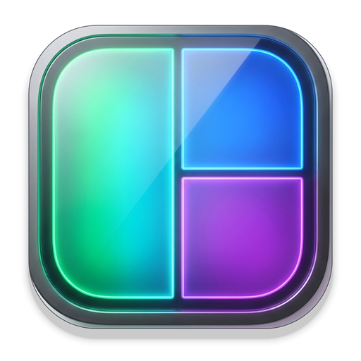

# ScreenSplit

<div align="center">



### 纯绿色便携 · Windows 边缘智能吸附分屏与多窗口管理器
**纯鼠标直觉交互 · 240Hz 电竞级超流畅动画 · 窗口尺寸智能记忆 · macOS 26 美学更新**

[](https://github.com/Crucialmer/ScreenSplit/releases)
[](LICENSE)
[](https://www.microsoft.com/windows)
[](#)
[](#)

</div>

---

## 📖 软件简介

**ScreenSplit** 是一款专为 Windows 10 / Windows 11 设计的现代、轻量、纯绿色便携的**边缘智能吸附分屏与多窗口管理器**。

不同于传统复杂的平铺式窗口管理器，ScreenSplit 彻底摆脱了复杂的键盘快捷键记忆与干扰性的顶部悬浮菜单，回归最直觉、最优雅的**纯鼠标边缘拖拽交互**。无论您是多显示器高效办公、程序员双屏对照编码，还是日常多任务浏览，ScreenSplit 都能让您的桌面窗口井然有序、随心自如。

---

## ✨ 核心特性

### 1. 纯鼠标直觉边缘智能吸附（四边缘 1/2 分屏）
- **直觉停靠**：按住窗口标题栏拖动至屏幕**左、右、上、下**任意边缘，系统即刻高帧率呈现拟态半透明半屏/全屏吸附轮廓预演；
- **精准就位**：释放鼠标，窗口瞬间精准停靠吸附至对应半屏或最大化，无任何像素损耗；
- **拖离跟随**：鼠标拖拽窗口离开边缘时，半透明原始轮廓实时跟随光标，方便自由放置；松开鼠标窗口即刻平滑就位。

### 2. 窗口尺寸智能记忆与方向自适应（彻底解决变形 Bug）
- **毫秒级原始尺寸记忆**：窗口贴靠前，系统精确记忆用户手动调整的原始宽度与高度；
- **竖屏与窄长窗口完美支持**：无论代码编辑器、竖屏网页、文档，还是微信/钉钉等竖屏窄长窗口（宽度 < 高度），从边缘拖出时 **100% 精准恢复拖动前的原始尺寸与纵横比**；
- 彻底修复了传统贴靠工具在多次拖拽后将竖屏窗口强行拉伸成横屏大窗口的顽固缺陷。

### 3. 240Hz 电竞级超高刷新率平滑动画
- **极速丝滑**：全面适配 60Hz / 120Hz / 144Hz / 240Hz+ 高刷新率显示器；
- **硬件级实时渲染流水线**：重构动画线程与高精度时钟，窗口拖拽与轮廓跟随零撕裂、零抖动、零卡顿，带来如同物理世界般的流畅手感。

### 4. 100% 纯绿色便携运行（Pure Green & Zero Footprint）
- **单文件独立解压即用**：发布包仅约 8.8 MB，本地运行不依赖外部运行时环境；
- **零系统残留**：不写入任何 Windows 系统注册表，不污染用户的 `%APPDATA%` 或全局临时文件夹；
- **配置数据随拷随走**：程序所有配置（`settings.json`）与运行日志全部收纳于程序本体根目录下的 `./Data/` 文件夹中，拷入 U 盘随时在新设备上无缝使用。

### 5. 全新 Windows 11 Fluent Design 高清多分辨率图标
- **现代美学几何**：外沿采用磨砂黑钛金属 Squircle 圆角外框与反光微光，内部呈现翡翠绿、电光蓝、霓虹紫 3 分屏视窗几何架构；
- **全规格分辨率适配**：内置 256×256、128×128、64×64、48×48、32×32、24×24、16×16 全尺寸 32 位 ARGB；
- 无论在 Windows 11 浅色/深色主题任务栏、桌面图标还是系统托盘通知区，微缩状态下依然极致清晰、高对比度。

### 6. macOS 26 极简拟态毛玻璃检查更新与应用内无感升级
- **告别 Windows 原生生硬弹窗**：彻底剔除系统自带 `MessageBox` 弹窗，采用纯正 macOS 悬浮卡片、红黄绿微距交通灯、环境漫反射光影与胶囊药丸按钮；
- **应用内流式高速更新**：流式下载 GitHub Release 最新更新包，实时展示动态进度条、已下载大小（MB）与下载速率（MB/s）；
- **一键重启热替换**：下载校验完毕后，点击「立即重启并完成更新」，后台自动完成新旧版本文件安全热替换并重新启动，用户的 `./Data/` 目录与个人设置 **100% 完好无损保留**。

### 7. 首次运行智能引导与静默常驻
- **首次贴心指引**：初次打开软件自动弹出精美引导卡片，直观介绍四边缘分屏与记忆还原技巧；
- **后续静默不打扰**：引导卡片关闭后默认不再弹窗打扰，开机或启动时自动静默常驻任务栏右下角系统托盘；
- **系统生态友好**：托盘右键菜单提供「恢复系统原生贴靠退出软件即可」与直接恢复开关，与 Windows Aero Snap 完美共存。

---

## 🚀 快速上手

### 下载与运行
1. 前往 [GitHub Releases](https://github.com/Crucialmer/ScreenSplit/releases) 下载最新正式版压缩包 `ScreenSplit.zip`；
2. 解压至任意目录（例如 `D:\Tools\ScreenSplit` 或桌面）；
3. 双击运行 `ScreenSplit.exe` 即可直接使用！
4. 软件常驻于桌面右下角系统托盘（若托盘图标隐藏，请点击 `^` 展开查看）。

### 托盘功能菜单
右键点击系统托盘的 ScreenSplit 图标即可呼出功能菜单：
- **恢复系统原生贴靠退出软件即可**：退出 ScreenSplit 并自动恢复 Windows 系统的原生 Aero Snap 贴靠功能；
- **检查更新**：呼出全新 macOS 26 美学风格检查更新面板，支持应用内一键下载与自动重启升级；
- **设置 / 使用指南**：自定义边距、动画、显示器偏好与开机自启选项；
- **退出**：干净退出程序。

---

## 🛠️ 从源码构建

本项目基于 .NET 10.0 与 WPF 开发，原生采用 win-x64 架构：

```powershell
# 1. 克隆代码仓库及子模块
git clone --recursive https://github.com/Crucialmer/ScreenSplit.git
cd ScreenSplit

# 2. 编译并发布 Release 单文件便携版
dotnet publish FancyWM/FancyWM.csproj -c Release -r win-x64 --no-self-contained -o publish/

# 3. 输出文件位于 publish/ScreenSplit.exe
```

---

## 📄 开源许可证

本项目采用 [MIT 许可证](LICENSE) 开源。

Copyright © 2026 Crucialmer. All Rights Reserved.
